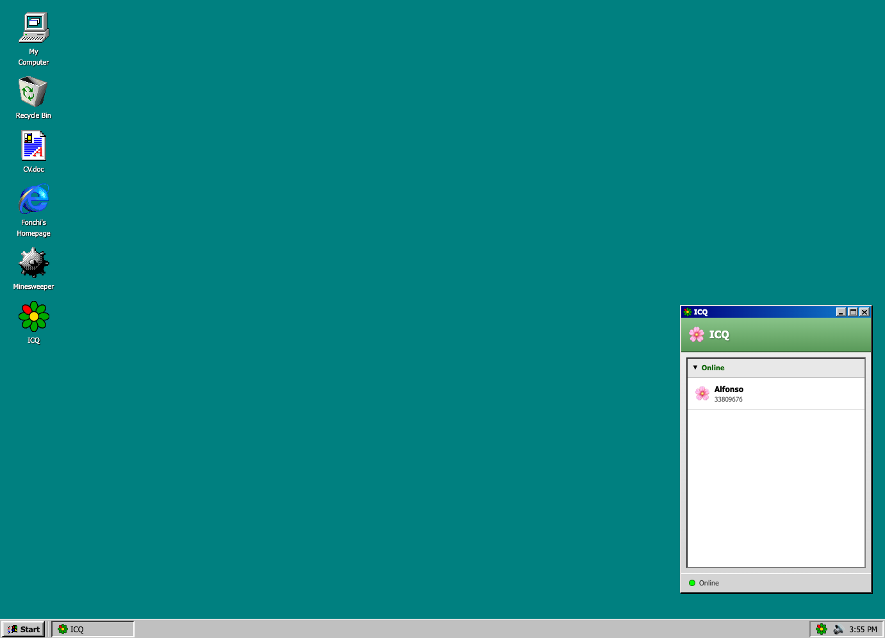

# Windows 95 Portfolio Site

A Windows 95 desktop simulation that serves as an interactive portfolio experience. Built with React, TypeScript, and styled-components.

**Live Demo:** [win.ridao.ar](https://win.ridao.ar)



## Features

### Desktop Environment
- Classic Windows 95 teal desktop background
- Draggable, resizable windows with authentic styling
- Minimize/maximize/close window controls
- Taskbar with Start button, running apps, and system tray
- Desktop icons with double-click to open

### Applications

| App | Description |
|-----|-------------|
| **ICQ Messenger** | Chat with my AI digital twin powered by Gemini. Features classic ICQ flower logo, contact list, "uh-oh!" notification sound, and typing indicators. |
| **CV.doc** | View my CV in an Adobe Acrobat Reader 3.0 styled PDF viewer with page navigation and zoom controls. |
| **Fonchi's Homepage** | Browse a 90s-style personal homepage with guestbook |
| **Minesweeper** | Classic Minesweeper game |
| **My Computer** | Windows Explorer-style file browser |
| **Recycle Bin** | Empty trash can |

### Start Menu
- Programs submenu with all applications
- Documents quick access
- Disabled Settings, Find, Help, and Run placeholders
- Shut Down (redirects to terminal site)

### System Tray
- ICQ status indicator with unread message badge
- Volume mute/unmute toggle
- Real-time clock

### Boot Sequence
- Authentic Windows 95 startup screen
- Progress bar animation

## Tech Stack

- **Framework:** React 19 + TypeScript
- **Build Tool:** Vite
- **UI Components:** [React95](https://react95.io/)
- **Styling:** styled-components
- **PDF Viewer:** react-pdf
- **AI Chat:** Google Gemini API via AWS Lambda
- **Hosting:** AWS Amplify

## Getting Started

### Prerequisites
- Node.js 20.19+ or 22.12+ (required by Vite 7)
- npm or yarn

### Installation

```bash
# Clone the repository
git clone https://github.com/fonCki/win-site.git
cd win-site

# Install dependencies
npm ci

# Set up environment variables
cp .env.example .env
# Edit .env with your API endpoints

# Start development server
npm run dev
```

### Build for Production

```bash
npm run build
```

## Environment Variables

Copy `.env.example` to `.env` and configure:

| Variable | Description |
|----------|-------------|
| `VITE_API_BASE_URL` | Base URL for API endpoints (chat, CV, guestbook) |
| `VITE_IP_API_URL` | IP lookup service URL (optional) |
| `VITE_ANALYTICS_ENABLED` | Optional override: `true` or `false`; enabled in production and disabled in development by default |

## Project Structure

```
src/
├── components/
│   ├── Boot/           # Boot screen animation
│   ├── Desktop/        # Desktop, Taskbar, StartMenu, Icons
│   ├── Windows/        # Window management
│   └── Apps/           # Individual applications
│       ├── ICQ/        # ICQ messenger
│       ├── CVViewer/   # PDF viewer
│       ├── Browser/    # Homepage browser
│       ├── Games/      # Minesweeper
│       └── MyComputer/ # File explorer
├── services/
│   ├── chatService.ts      # Gemini API integration
│   └── guestbookService.ts # Guestbook functionality
├── hooks/
│   └── useSessionTracking.ts
└── App.tsx
```

## Related Projects

- **Terminal Site:** [alfonso.ridao.ar](https://alfonso.ridao.ar) - My CLI-style portfolio

## Authors

- [Alfonso Ridao](https://alfonso.ridao.ar)
- For support, email alfonso@ridao.ar.

## 🚀 About Me

I'm a time traveler

## Validation and regression tests

```bash
npm ci
npx playwright install chromium webkit
npm run check:privacy
npm run typecheck
npm run lint
npm run build
npm test
```

`npm test` runs window geometry checks plus real Chromium/WebKit browser tests at
1440×900, 1280×720, 768×1024, 390×844, 320×568, and 844×390. Tests cover the boot
screen, app launch/close, resizing/rotation, maximize/restore, minimized game state,
PDF rendering/pagination/retry, chat history/errors, guestbook reads/submissions,
Start menu keyboard control, touch activation, mute persistence, and music player
lifecycle. API responses and YouTube are controlled fixtures; test guestbook entries
never reach the production service. The suite starts its own server on port 5177.
Screenshots and failure traces go to `test-results/`; the HTML report is at
`playwright-report/index.html`.

Read-only production checks (including the actual CV download and CORS):

```bash
npm run test:live
# Also send one short prompt to the real AI backend:
npm run test:live -- --chat
```

The live check reads `.env`, does not print storage locations or signed URL credentials, and writes a
summary to `test-results/live-checks.json`. It does not submit guestbook entries.

The privacy check rejects tracked personal documents, deployment archives, environment
files and concrete storage URLs. Run it before publishing changes.

## Updating profile content

The CV viewer displays a PDF supplied by the backend. The chatbot's profile is
maintained separately from this frontend. Keep personal documents, profile text,
backups, and storage configuration outside this repository. Updating the PDF does
not update the chatbot's knowledge; these are separate content updates.

Homepage text lives in `src/components/Apps/Browser/HomePage.tsx`; the ICQ welcome
message lives in `src/components/Apps/ICQ/ICQ.tsx`.

## Review notes — 2026-10-28

The local project and Git metadata were almost entirely empty. Recovered the
working source and Git history from a private backup; preserved the original
local copy separately. `git fsck --full` passed after recovery.

Repairs include uncropped boot artwork, windows constrained to the screen above
the taskbar, responsive homepage/PDF layout, working keyboard/touch app launch,
Start menu sizing, state preservation when minimizing, ICQ greeting/timer races,
request timeout/error handling, independent guestbook read/visit behavior, and
music cleanup/track advancement. The missing `startup.mp3` request was removed;
there is no startup audio asset in the recovered project. The PDF worker is now
bundled locally and the viewer is loaded on demand. Initial JavaScript fell from
about 830 kB to 404 kB before gzip. Compatible dependency updates resolved the
17 findings in the restored npm audit; no forced major upgrades were used.

Live checks confirmed the website, CV API/download, guestbook read, chat CORS, and
actual AI responses. Personal profile content is maintained and versioned privately.

Final checks: **80/80 automated tests passed**, including seven Chromium/WebKit
viewport configurations; type checks, lint, production build, and Git whitespace
checks passed. Final npm audit: **0 vulnerabilities**. A further seven PDF
checks confirmed that actual text was painted after zooming, not just a blank
canvas. Their screenshots are in `test-results-pdf/`.

### Remaining limits and follow-up work

- This is a desktop simulation: My Computer drives, generic File/Edit/View/Help
  menus, several IE controls, Winamp title buttons, and Web Ring links are
  decorative or explicitly disabled. They are not complete applications.
- Browser tests control YouTube responses. Real music playback still depends on
  YouTube availability, embedding restrictions, and browser autoplay policy;
  audible playback was not verified. Third-party decorative images also require
  network access.
- The NAS backend contains origin checks using `referer.startsWith(...)`, and
  guestbook writes lack a server-side origin check/rate limit in that source.
  CORS is not authentication. Review the deployed backend for abuse protection
  before expanding public write functionality. Backend code was inspected but
  not modified or deployed from this frontend project.
- An older backend backup lacks the CV route. Reconcile backend versions before
  deploying any recovered backend code.
- Production analytics stores chat text and IP addresses. The existing behavior
  remains; confirm that this is still the intended retention policy. Local
  development analytics is disabled by default.
